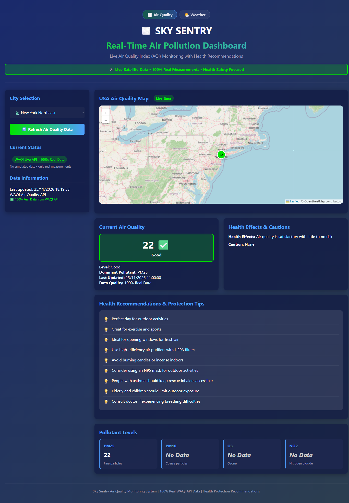
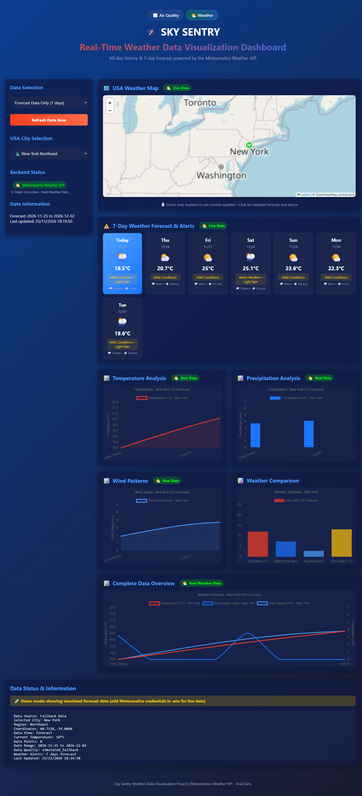
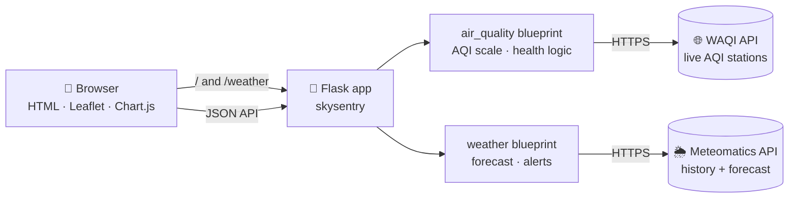

<div align="center">

# 🛰️ SkySentry

### Real-Time Air Quality & Weather Protection Platform

**Built for the NASA Space Apps Challenge 2025**

[](https://github.com/mohamedZouari1/sky-sentry/actions/workflows/ci.yml)


[](LICENSE)

*Turning complex atmospheric data into life-protecting guidance.*



</div>

---

## 🌍 Overview

**SkySentry** is a real-time air quality protection platform. It combines live pollution measurements from the **World Air Quality Index (WAQI)** network with **Meteomatics** meteorological data to deliver air quality monitoring, a seven-day weather outlook and **dynamic health recommendations** for 12 major US cities.

By correlating **weather patterns with pollution levels**, SkySentry produces proactive alerts that adapt to changing conditions. This helps vulnerable people (children, the elderly and those with asthma or heart conditions) make informed decisions about outdoor activity.

## ✨ Features

| | Feature | Details |
|---|---|---|
| 🌫️ | **Live AQI monitoring** | Real-time Air Quality Index from WAQI stations, colour-coded on the US EPA scale |
| 🧪 | **Pollutant breakdown** | PM2.5, PM10, O₃, NO₂ (plus SO₂ and CO when available), with the dominant pollutant highlighted |
| 🫁 | **Health guidance** | Recommendations tailored to the AQI level *and* the dominant pollutant (e.g. HEPA filters for PM2.5, morning activity for ozone) |
| 🗺️ | **Interactive maps** | Leaflet maps with live markers for each monitored city |
| 🌤️ | **Weather intelligence** | 60-day history and 7-day forecast of temperature, precipitation and wind |
| ⚠️ | **Daily weather alerts** | Heat, freezing, rain and wind warnings with an at-a-glance icon for each day |
| 📊 | **Rich charts** | Chart.js visualizations for temperature, precipitation, wind and a combined overview |
| 🛡️ | **Honest data** | Every response states its source and quality; if a feed is unavailable the UI says so instead of inventing numbers |

## 📸 Screenshots

<table>
<tr>
<td width="50%"><b>🌫️ Air Quality</b><br></td>
<td width="50%"><b>🌤️ Weather &amp; Forecast</b><br></td>
</tr>
</table>

## 🏗️ Architecture



## 🚀 Quick start

**Requirements:** Python 3.10 or newer.

```bash
git clone https://github.com/mohamedZouari1/sky-sentry.git
cd sky-sentry

python -m venv .venv
# Windows: .venv\Scripts\activate    macOS/Linux: source .venv/bin/activate
pip install -r requirements.txt

cp .env.example .env      # then add your API keys (Windows: copy .env.example .env)
python run.py
```

Then open **http://localhost:5000** for air quality and **http://localhost:5000/weather** for the weather dashboard.

### 🔑 API keys

| Variable | Where to get it | Without it |
|---|---|---|
| `WAQI_API_TOKEN` | Free at [aqicn.org/data-platform/token](https://aqicn.org/data-platform/token/) | The air quality page shows **"No Data"** |
| `METEOMATICS_USERNAME` / `METEOMATICS_PASSWORD` | [meteomatics.com](https://www.meteomatics.com/en/weather-api/) | The weather page runs in **demo mode** with clearly labelled simulated data |

Keys are read from environment variables or a local `.env` file. `.env` is git-ignored, so **never commit real keys**.

## 🔌 REST API

| Endpoint | Description |
|---|---|
| `GET /api/status` | Service health, version and which integrations are configured |
| `GET /api/cities` | The 12 monitored cities with coordinates and regions |
| `GET /api/air-quality/<city>` | Live AQI, pollutants, health effects and recommendations |
| `GET /api/historical/<city>` | Current AQI and PM2.5 trend point (the free WAQI tier has no history) |
| `GET /api/weather/forecast/<city>` | 7-day forecast and daily weather alerts |
| `GET /api/weather/historical/<city>` | Last 60 days of temperature, precipitation and wind |

City keys: `new_york`, `los_angeles`, `chicago`, `houston`, `phoenix`, `philadelphia`, `san_antonio`, `san_diego`, `dallas`, `san_jose`, `seattle`, `boston`.

<details>
<summary>Example response: <code>/api/air-quality/chicago</code></summary>

```json
{
  "city_display": "Chicago",
  "aqi": 72,
  "aqi_level": "Moderate",
  "aqi_color": "#ffff00",
  "dominant_pollutant": "pm25",
  "pollutants": { "pm25": 72, "o3": 21 },
  "health_effects": "Acceptable quality but slight concern for sensitive groups",
  "recommendations": ["Sensitive groups should reduce prolonged outdoor exercise", "..."],
  "data_source": "WAQI Air Quality API",
  "has_real_data": true
}
```
</details>

## 🩺 AQI scale used

| AQI | Level | Guidance |
|---|---|---|
| 0–50 | 🟢 Good | Ideal for outdoor activity |
| 51–100 | 🟡 Moderate | Unusually sensitive people should limit prolonged exertion |
| 101–150 | 🟠 Unhealthy for Sensitive Groups | Children, the elderly and people with lung disease should reduce exertion |
| 151–200 | 🔴 Unhealthy | Everyone should reduce outdoor exertion |
| 201–300 | 🟣 Very Unhealthy | Avoid outdoor exertion; use purifiers and N95 masks |
| 301+ | 🟤 Hazardous | Emergency conditions: stay indoors |

## 📁 Project structure

```
sky-sentry/
├── run.py                    # Entry point: python run.py
├── skysentry/
│   ├── __init__.py           # App factory, page routes, /api/status
│   ├── air_quality.py        # WAQI integration, AQI scale, health recommendations
│   ├── weather.py            # Meteomatics integration, forecasts, weather alerts
│   ├── cities.py             # Monitored cities
│   ├── config.py             # Environment-based configuration
│   └── static/
│       ├── air-quality.html  # Air quality dashboard
│       └── weather.html      # Weather dashboard
├── scripts/check_waqi.py     # CLI: print live AQI for every city
├── tests/                    # Offline pytest suite (APIs mocked)
├── docs/screenshots/
├── .env.example
└── requirements.txt
```

## 🧪 Tests

```bash
pip install -r requirements-dev.txt
pytest
```

The suite mocks every external API, so it needs no keys or network access. It runs on each push through GitHub Actions.

## 💡 Why it matters

- 🫁 **Health protection:** timely alerts for sensitive groups
- 🌤️ **Smart planning:** combines weather and pollution so people can plan safer outdoor time
- 💬 **Accessible:** plain-language guidance, no technical knowledge needed
- 👥 **Community empowerment:** equal access to atmospheric information for everyone

## 🛰️ NASA & partner data sources

| Source | Role |
|---|---|
| **WAQI: World Air Quality Index** | Global real-time air pollution data and AQI |
| **Meteomatics Weather API** | Meteorological history and forecasts |
| **NASA Earth Science & atmospheric datasets** | Cross-referenced for validation during development |

## 🧠 Use of AI

AI was used **only for code refinement and documentation enhancement**, with **DeepSeek AI** during the hackathon. The repository was later restructured, tested and documented with help from **Claude (Anthropic)**.

## 📄 License

Released under the [MIT License](LICENSE).

<div align="center">

Made with 💙 for the **NASA Space Apps Challenge 2025**

</div>
