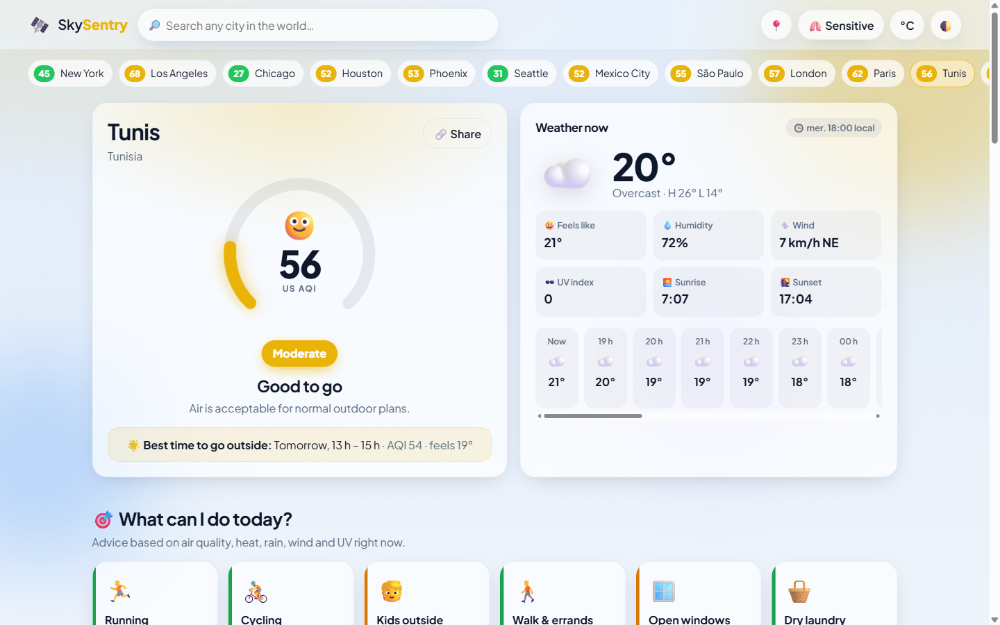
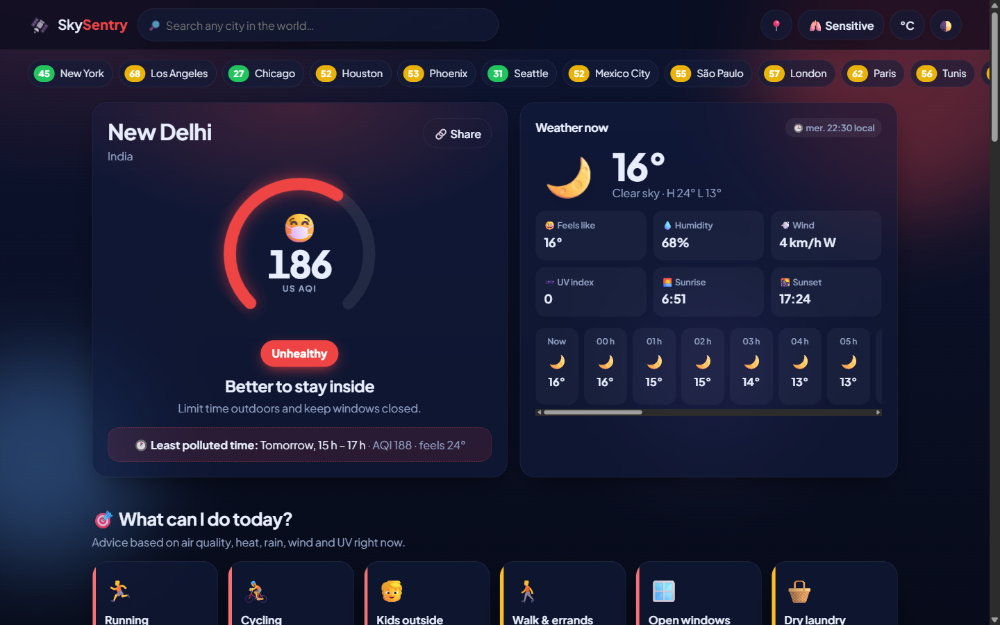
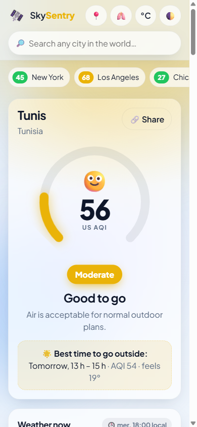
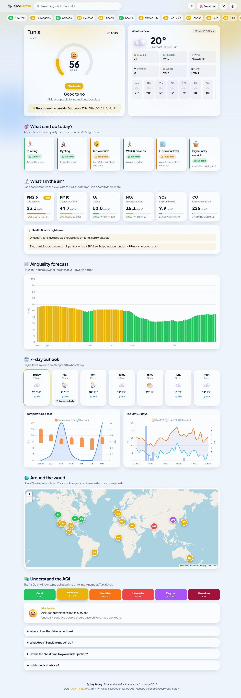
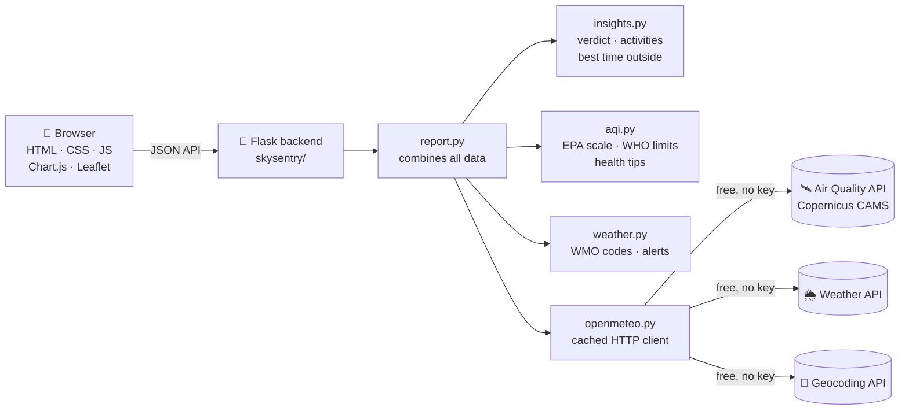

<div align="center">

# 🛰️ SkySentry

### Is the air safe to breathe today?

Real-time air quality, weather and friendly health advice for **any city on Earth**.
Free and open, with **no API keys required**.

**Built for the NASA Space Apps Challenge 2025** · v2.0

[](https://github.com/mohamedZouari1/sky-sentry/actions/workflows/ci.yml)


[](LICENSE)



</div>

---

## 🌍 What is SkySentry?

Air pollution is invisible, and most air quality sites bury you in numbers. **SkySentry answers the question people actually ask: _"Can I go outside?"_**

It combines **satellite-based air quality data** from the European **Copernicus Atmosphere Monitoring Service (CAMS)** with live weather forecasts. It then turns them into clear, color-coded advice: what's safe to do right now, the best time to head out, and how to protect yourself when the air is bad.

## ✨ Features

| | Feature | What it does |
|---|---|---|
| 🔎 | **Any city, worldwide** | Search for any place on Earth, use 📍 your location, or click anywhere on the map |
| 🎯 | **Animated AQI gauge** | Live US AQI with a mascot that reacts to the air (😄 → 🙂 → 😐 → 😷 → 🤢 → ☠️) |
| 🌟 | **Best time outside** | Scans the coming daylight hours for the cleanest, most comfortable two-hour window |
| 🏃 | **Activity advisor** | Go / caution / skip for running, cycling, kids playing, walking, opening windows and drying laundry |
| 🫁 | **Sensitive mode** | Stricter EPA guidance for asthma, heart conditions, kids, seniors and pregnancy |
| 🔬 | **Pollutant breakdown** | PM2.5, PM10, O₃, NO₂, SO₂ and CO compared with **WHO limits**, with tap-to-learn explanations |
| 📈 | **4-day AQI forecast** | Hour-by-hour chart color-coded by health level |
| 🌤️ | **Weather** | Current conditions, a 24-hour strip, a 7-day outlook with alerts (heat, frost, storms, wind, UV) and a 30-day history |
| 🗺️ | **World map** | Live AQI bubbles for 17 featured cities across 6 continents |
| 🌓 | **Make it yours** | Light/dark theme, °C/°F, shareable links, keyboard shortcut (`/` to search) and a mobile-friendly layout |

## 📸 Screenshots

<table>
<tr>
<td width="62%"><b>🌙 Dark mode: an unhealthy day in New Delhi</b><br></td>
<td width="38%"><b>📱 On your phone</b><br></td>
</tr>
</table>

<details>
<summary><b>🖼️ See the full page</b></summary>
<br>

</details>

## 🚀 Quick start

**Requirements:** Python 3.10 or newer. That's it, no accounts or keys.

```bash
git clone https://github.com/mohamedZouari1/sky-sentry.git
cd sky-sentry

python -m venv .venv
# Windows: .venv\Scripts\activate    macOS/Linux: source .venv/bin/activate
pip install -r requirements.txt

python run.py
```

Then open **http://localhost:5000** 🎉

Want a quick look from the terminal? Run `python scripts/air_report.py` for a live AQI table of all featured cities.

## 🏗️ How it works



The backend caches every Open-Meteo response for 10 minutes and fetches all 17 featured cities in just **two** batched requests, which keeps the app fast and gentle on the free API.

## 🔌 REST API

| Endpoint | Description |
|---|---|
| `GET /api/conditions?lat=&lon=[&sensitive=1]` | The full report: AQI, pollutants, forecast, weather, history, verdict, activities and best time outside |
| `GET /api/search?q=` | Find places by name (worldwide) |
| `GET /api/overview` | Live AQI and weather for all featured cities |
| `GET /api/cities` | The featured city list |
| `GET /api/scale` | AQI levels and pollutant reference data |
| `GET /api/status` | Health check |

<details>
<summary>Example: <code>/api/conditions?lat=36.81&lon=10.18</code> (trimmed)</summary>

```json
{
  "air": {
    "aqi": 56,
    "level": { "label": "Moderate", "color": "#eab308", "mascot": "🙂" },
    "dominant": "pm2_5",
    "pollutants": [{ "key": "pm2_5", "name": "PM2.5", "value": 23.1, "who": 15, "ratio": 1.54 }],
    "tips": ["Unusually sensitive people should ease off long, hard workouts."]
  },
  "weather": { "now": { "temperature": 20.0, "label": "Overcast", "icon": "☁️" } },
  "insights": {
    "verdict": { "status": "go", "title": "Good to go" },
    "best_window": { "day": "Tomorrow", "start": "2026-11-26T13:00", "aqi": 54 },
    "activities": [{ "name": "Running", "status": "go", "reason": "Air quality is fine" }]
  }
}
```
</details>

## 🩺 The AQI scale

| AQI | Level | What it means |
|---|---|---|
| 0–50 | 🟢 Good | Clean air. Enjoy it! |
| 51–100 | 🟡 Moderate | Fine for most people. Unusually sensitive people should ease off hard workouts |
| 101–150 | 🟠 Unhealthy for Sensitive Groups | Kids, seniors and people with asthma or heart disease should cut back |
| 151–200 | 🔴 Unhealthy | Everyone should keep outdoor activity short and light |
| 201–300 | 🟣 Very Unhealthy | Avoid exertion outdoors, close windows and use an air purifier |
| 301+ | 🟤 Hazardous | Emergency conditions: stay indoors |

## 📁 Project structure

```
sky-sentry/
├── run.py                  # python run.py  ->  http://localhost:5000
├── skysentry/
│   ├── __init__.py         # Flask app factory + API routes
│   ├── openmeteo.py        # Cached client for the free Open-Meteo APIs
│   ├── report.py           # Builds the JSON reports
│   ├── insights.py         # Verdict, activity advisor, best time outside
│   ├── aqi.py              # AQI levels, WHO limits, health tips
│   ├── weather.py          # Weather codes and daily alerts
│   ├── cities.py           # Featured cities
│   ├── config.py           # Optional settings (port, cache time)
│   └── static/             # index.html, css/app.css, js/app.js
├── scripts/air_report.py   # Live AQI table in your terminal
├── tests/                  # Offline pytest suite (APIs mocked)
└── docs/screenshots/
```

## 🧪 Tests

```bash
pip install -r requirements-dev.txt
pytest
```

The suite mocks Open-Meteo completely, so it runs offline. GitHub Actions runs it on every push.

## 🆕 What changed in v2

The 2025 hackathon version used the WAQI API and Meteomatics, which both needed personal API keys and only covered 12 US cities. Version 2 is a full rebuild:

- **Free, keyless data** from Open-Meteo and Copernicus CAMS: clone it and it just works
- **The whole world** instead of 12 US cities: search, geolocation and click-on-map
- **A new single-page design** with light/dark themes, animations and full mobile support
- **Smarter advice**: activity advisor, best time outside, sensitive mode and WHO comparisons
- **Real forecasts everywhere**: no more simulated fallback data

## 🛰️ Data sources

| Source | Used for |
|---|---|
| [Open-Meteo Air Quality API](https://open-meteo.com/en/docs/air-quality-api) | US AQI and pollutant concentrations from **Copernicus CAMS**, which combines satellite observations with atmospheric models |
| [Open-Meteo Weather API](https://open-meteo.com/en/docs) | Current weather, forecasts and recent history |
| [Open-Meteo Geocoding API](https://open-meteo.com/en/docs/geocoding-api) | City search |
| [OpenStreetMap](https://www.openstreetmap.org/copyright) | Map tiles |

Weather and air quality data by [Open-Meteo.com](https://open-meteo.com/), licensed under [CC BY 4.0](https://creativecommons.org/licenses/by/4.0/). Contains modified Copernicus Atmosphere Monitoring Service information. Open-Meteo's free tier is for non-commercial use.

> ⚠️ SkySentry provides general guidance from public data and is **not medical advice**. Always follow your doctor and your local authorities.

## 🧠 Use of AI

During the hackathon, AI was used **only for code refinement and documentation enhancement**, with **DeepSeek AI**. Version 2 was redesigned and rebuilt with help from **Claude (Anthropic)**.

## 🤝 Contributing

Ideas, bug reports and pull requests are welcome! Open an issue to suggest a feature or report a problem.

## 📄 License

Released under the [MIT License](LICENSE).

<div align="center">

Made with 💙 for the **NASA Space Apps Challenge 2025**

</div>
